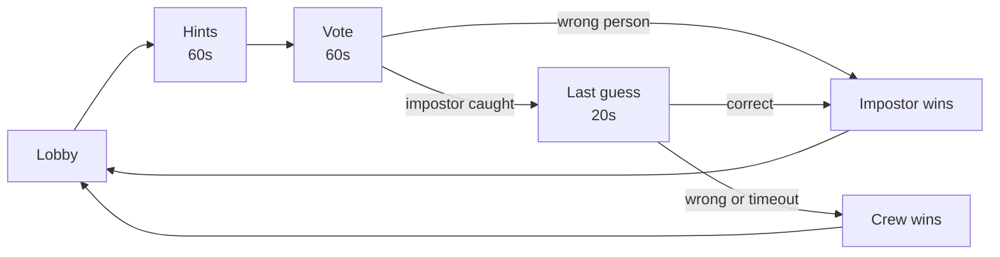
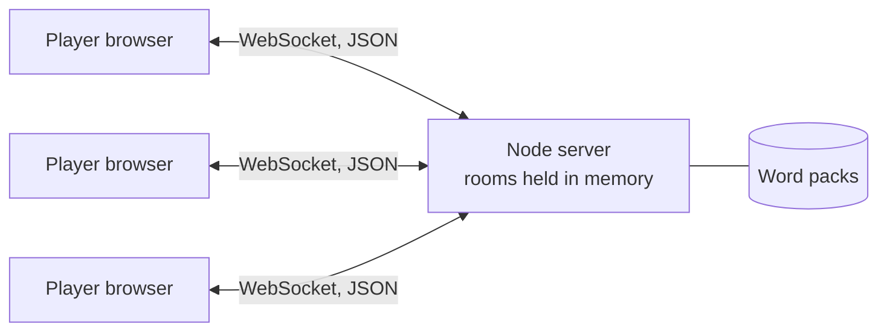

<h1 align="center">Impostor</h1>

<p align="center">
  <em>A game of quiet suspicion.</em><br>
  One secret word, one bluffer, and a table full of friends working out who it is.
</p>

<p align="center">
  
  
  
  
</p>

<p align="center">
  <a href="#how-to-play">How to play</a> ·
  <a href="#getting-started">Getting started</a> ·
  <a href="#architecture">Architecture</a> ·
  <a href="#protocol">Protocol</a> ·
  <a href="#deployment">Deployment</a> ·
  <a href="#roadmap">Roadmap</a>
</p>

<!-- Add a screenshot or GIF here:
<p align="center"></p>
-->

---

## Overview

Impostor is a social deduction party game that runs entirely in the browser. One person creates a room, everyone else joins from a link on their own phone, and a round takes only a few minutes. There is nothing to install, no account to create, and no setup.

Everyone except one player is told the same secret word. The impostor is not, and has to bluff their way through a round of one-word hints without being found out.

## Features

- **Instant rooms.** Create a room, share a code or invite link, and play. No sign-up.
- **Private roles.** Each player taps to reveal their own card, so nothing is visible over a shoulder.
- **Server-authoritative.** The secret word is only ever sent to the crew. A browser cannot read what it was never given.
- **Live round.** Timers for hints, voting and the impostor's last guess, with a clear verdict and recap at the end.
- **Built for phones.** Responsive layout, large touch targets, safe-area support, and light and dark themes.
- **Resilient lobby.** Host handover when the host leaves, clean handling of disconnects, and a gentle wake-up flow for hosts that sleep when idle.
- **Zero build tooling.** The client is a single HTML file, and the server is one Node script.

## How to play

1. **Gather.** The host creates a room and shares the code. Three or more players are needed, and it plays best with four to eight.
2. **Secret roles.** Everyone sees the same word, except the impostor, who is only told the category.
3. **Hints.** Each player submits a one-word hint that proves they know the word without giving it away. The impostor has to blend in.
4. **Vote.** Everyone reads the hints and votes for who they think is bluffing.
5. **Verdict.**
   - If the crew votes for the wrong person, **the impostor wins**.
   - If the impostor is caught, they get **one last guess** at the word. A correct guess steals the win. Otherwise **the crew wins**.
6. **Play again.** The host returns everyone to the lobby for a new word and a new impostor.



## Getting started

### Prerequisites

- Node.js 18 or newer

### Run the server

```bash
git clone https://github.com/YOUR_USERNAME/impostor.git
cd impostor
npm install ws nanoid
```

The server uses ES module imports, so make sure your `package.json` includes:

```json
{
  "type": "module"
}
```

Then start it:

```bash
node server.js
```

The server listens on `PORT` (default `8080`) and serves a health check at `/ping`.

### Open the client

The client is a static file, so you can double-click it or serve it with any static host. To point it at your local server, add a `server` parameter:

```
index.html?server=ws://localhost:8080
```

Open it in two or three browser tabs, create a room in the first, and join from the others.

> **Tip:** an invite link looks like `index.html?room=ABCD` and pre-fills the room code.

## Configuration

| Setting | Where | Default | Notes |
| --- | --- | --- | --- |
| `PORT` | server environment | `8080` | Set automatically by most hosts |
| Hint, vote and guess timers | `server.js` | 60s, 60s, 20s | Passed to `setTimeout` in milliseconds |
| `SUBMIT`, `VOTE`, `GUESS` | top of the client script | 60, 60, 20 | Seconds. **Keep in sync with the server timers** |
| `SERVER` | top of the client script | your hosted URL | Overridden by the `?server=` parameter |
| `wordPacks` | `server.js` | four packs | Categories and their words |

### Word packs

Packs are plain arrays grouped by category. The impostor is shown the category, so keep words in a pack closely related.

```js
const wordPacks = {
  "Food":    ["apple", "orange", "lemon"],
  "Animals": ["dolphin", "tiger", "zebra"],
};
```

## Architecture



- **Client.** One HTML file with no framework and no build step. It sends player actions and renders whatever the server tells it.
- **Server.** A Node process using [`ws`](https://github.com/websockets/ws) for sockets and [`nanoid`](https://github.com/ai/nanoid) for player ids. It owns every secret, runs the phase timers, tallies votes and decides the outcome.
- **State.** Rooms, votes and timers live in memory, so restarting the server ends any active rounds.

## Protocol

Messages are JSON over a single WebSocket.

### Client to server

| `type` | Payload | Who | Purpose |
| --- | --- | --- | --- |
| `JOIN_ROOM` | `userName`, `roomId` | anyone | Join a room, creating it if it does not exist |
| `EXIT_ROOM` | `roomId` | anyone | Leave the room |
| `START_ROOM` | `roomId` | host | Pick a word and an impostor, begin the round |
| `INPUT_SUBMIT` | `roomId`, `input` | player | Submit a one-word hint |
| `VOTE_SUBMIT` | `roomId`, `targetId` | player | Vote for a suspect |
| `IMPOSTOR_GUESS` | `roomId`, `inputWord` | impostor | Guess the word after being caught |
| `PLAY_AGAIN` | `roomId` | host | Return everyone to the lobby |

### Server to client

| Message | Payload | Meaning |
| --- | --- | --- |
| `status: "success"` | `participants` | Joined a room |
| `new player joined` | `userName` | Someone joined the lobby |
| `game started` | `role`, plus `secretWord` (crew) or `category` (impostor) | The round has begun |
| `voting started` | `answers` | Hints are revealed, voting is open |
| `make a guess to win the game` | none | You were caught, so guess the word |
| `impostor caught` | none | The impostor is guessing |
| `impostor won` | `impostorUsername`, `secretWord` | The crew voted for the wrong person |
| `crew loses` | `impostorUsername` | The impostor guessed correctly |
| `crew wins` | `impostorUsername` | The impostor guessed wrong |
| `teammate disconnect` | `userName` | A player left |
| `back to lobby` | `participants` | The host started a new round |
| `not authorized`, `not enough members`, `only host...` | none | Request rejected |
| `error occured` | `error` | Server-side error |

## Deployment

**Server.** Any Node host that supports WebSockets will do. On [Render](https://render.com), create a Web Service with:

- Build command: `npm install`
- Start command: `node server.js`

Free instances sleep when idle. Point a cron pinger (for example [cron-job.org](https://cron-job.org)) at `https://YOUR-APP.onrender.com/ping` every ten minutes to keep it awake. The client also wakes the server on load and sends a small keep-alive message while connected.

**Client.** Host the HTML file anywhere static: GitHub Pages, Netlify, Cloudflare Pages, or the same server. If the page is served over HTTPS, the server URL must use `wss://`.

## Project structure

```
.
├── server.js     # WebSocket game server and word packs
├── index.html    # Single-file game client
└── package.json
```

## Roadmap

- [ ] Custom word packs generated from a topic the host types in
- [ ] Related-word mode, where the impostor gets a similar word instead of nothing
- [ ] Themed packs (cricket, Bollywood, anime, seasonal)
- [ ] Scoring across rounds
- [ ] Rejoin a round in progress after a dropped connection
- [ ] Persistent rooms and horizontal scaling

## Known limitations

- Game state is held in memory on a single server instance.
- A player who disconnects during a round cannot rejoin that round.
- The word list is intentionally small, so packs will repeat quickly.

## Contributing

Issues and pull requests are welcome. For larger changes, please open an issue first to discuss what you would like to change.

## License

Released under the [MIT License](LICENSE). Replace this line with your own license if you prefer a different one.
